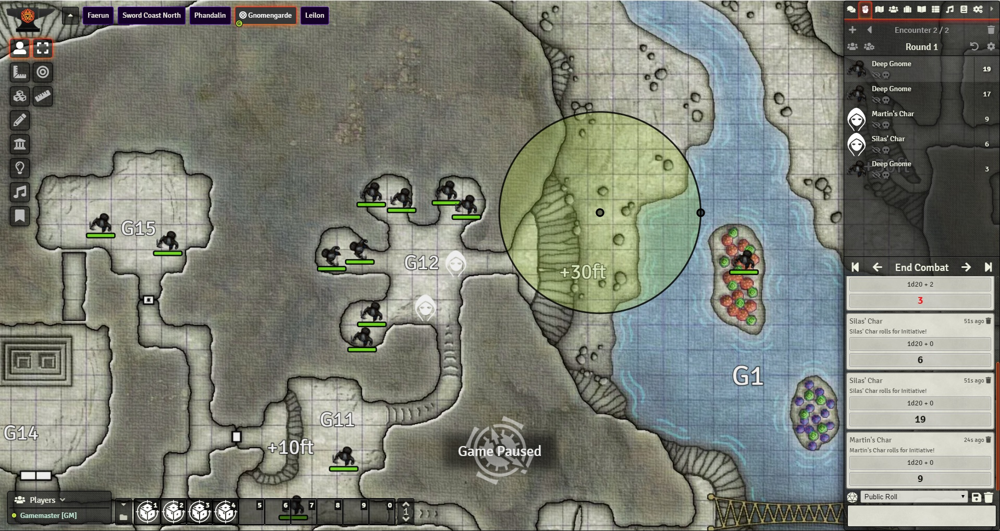
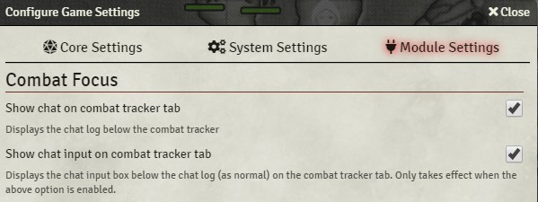

# Foundry Combat Focus

FoundryVTT-addon that shows the chat and the combat tracker at the same time. The point is to reduce the amount of 
switching players need to do between the combat tracker (to see who's turn it is) and the chat (to see the results 
of their and other peoples' actions).  

The current implementation requires **Foundry VTT v14**. Older Foundry versions can use release v1.4.2.

Features:

- Shows the chat window on the combat tracker tab (below the turn order)
- Can be enabled / disabled in the module settings by every player (might not work great on small screens).
- The height ratio between the combat tracker and the chat can be adjusted by dragging a handle between the two by each player individually
- The divider also supports Arrow Up/Down (Shift for larger steps) and Home to reset to equal heights.
- Chat input can be hidden independently in split view. The normal chat tab is unaffected.
- Split view uses a single-line-height editor without the formatting toolbar and a compact divider in the active theme's accent color.
- The native input, visibility controls and optional Dice Tray form a flush panel in split view, using CSS only.
- Opening the native chat popout temporarily suspends split view; closing it restores the split.

## How it works

Combat Focus displays the existing sidebar `ChatLog` below the existing `CombatTracker` using scoped CSS.
It does not clone messages, replace templates, or implement a second chat/editor. Foundry continues to handle
message rendering, system chat cards, commands, rolls, drafts, history, scrolling, context menus and popouts.

Foundry v14 replaced the old sidebar tab controller and changed the chat markup (including the ProseMirror
input and separate notification area). The old `ui.sidebar._tabs[0]` patch fails at startup, and the old
`activeTab`, `#chat-log` and `#chat-form` assumptions no longer apply.

The module extends the configured `CONFIG.ui.chat` class at initialization and overrides only the protected
`_shouldShowNotifications` policy while the docked combat split is visible. Core then docks its own editor
and controls and suppresses floating chat cards. Supported sidebar/render hooks keep the CSS state current.
On split transitions, the module calls core's internal `_toggleNotifications` refresh method; this is the
small v14-specific integration point to check when upgrading Foundry. No sidebar methods are patched.

All three existing client setting keys are retained. Resizing previews locally and saves the height once
on release. CSS bounds the saved height when the viewport becomes smaller.

## Development and verification

Run `npm test` (Node.js 18 or newer) for the dependency-free lifecycle, native-class delegation, settings,
resize bounds, UI scaling and cancellation regression tests.

Browser testing was performed on Foundry **14.369** with **PF2e 8.6.1**. When updating the integration, also
check native text and `/r` submissions, preserved drafts across tabs, combat rerenders, split/input toggles,
collapse/expand, chat popout open/close, pointer/keyboard resizing, and height persistence after reload.
The Node tests use a small host fixture; the browser checks exercise Foundry itself. Other systems and
sidebar replacement modules have not been verified.

Screenshots: 

If you want to show your support for my work financially, feel free to donate via PayPal - it's greatly appreciated! 

